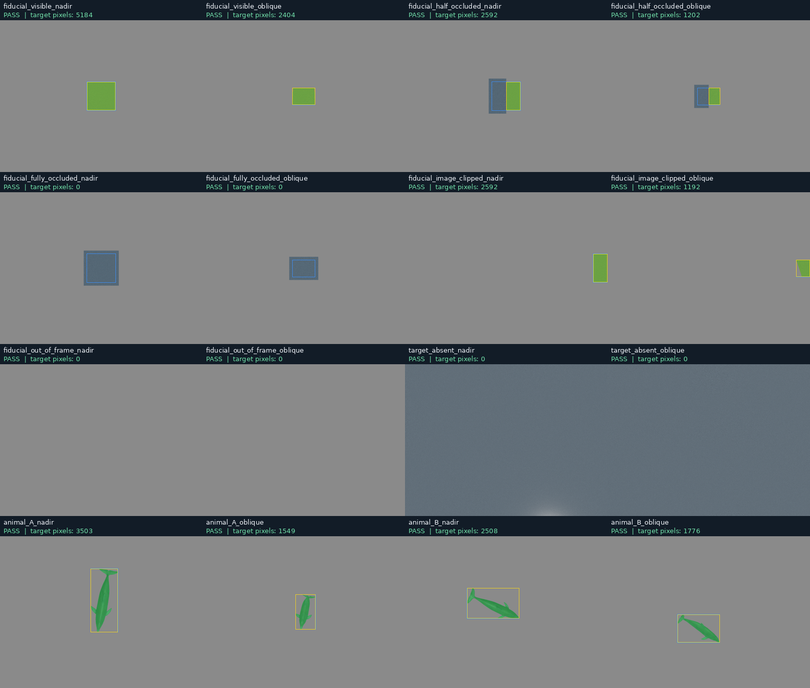
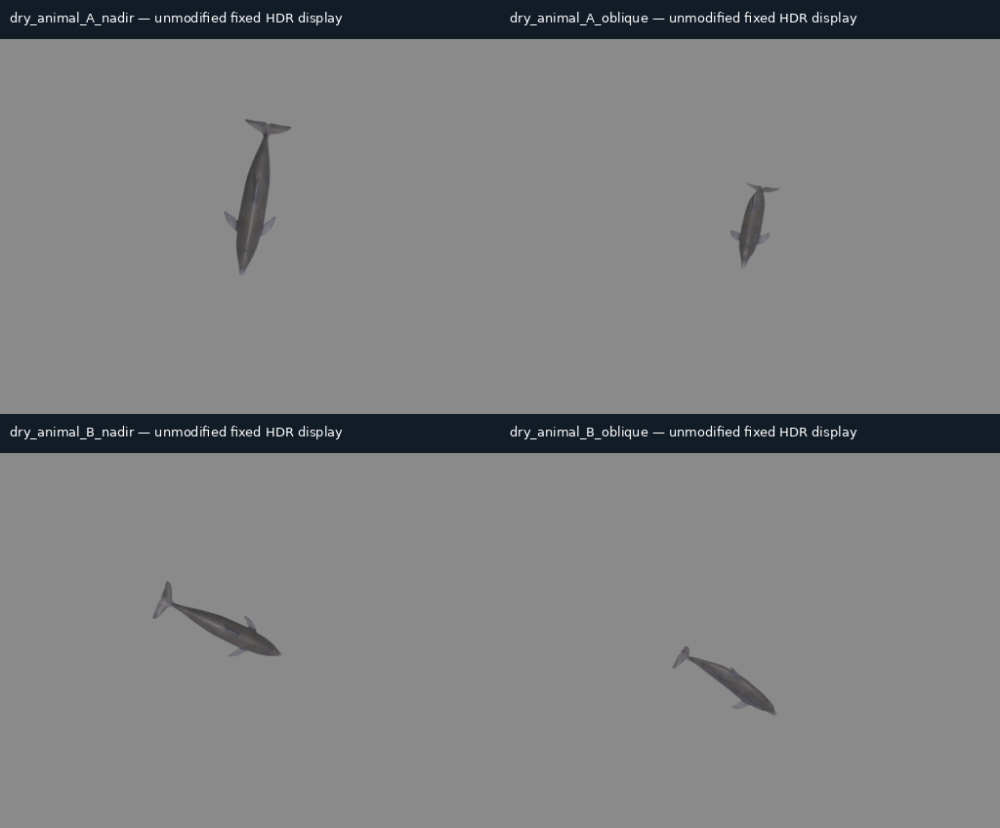

# M2 — Validate dry-scene geometry and native annotations

Revision: **above_water_m2_dry_validation_v2**. The sixteen captures and all numeric criteria are unchanged. The first packaging verifier incorrectly required the whole transaction's `clean_exit` flag, which also requires every case to pass. Four valid rows preceded the intentionally retained empty-scene failure in `dry02`; that worker closed every product/scene and deliberately exited with code 1. The corrected verifier checks the selected row passed, all owned products/scenes closed, no cleanup signals/deadline termination occurred, and the exit code matches the worker's success/failure result. It continues to require clean pre-capture lifecycle probes and preserves both the failed case and the original verifier failure. The original 702-file evidence seal remains byte-for-byte unchanged. This is a verifier/report correction, not a recapture, tolerance change or waiver of the native failure.

Sprint: **MARLIN — Above-Water Capture and Annotation Validation**. Technical checks passed on 10 November 2026. **Gate B remains pending; M2 has not received human acceptance. M3 has not started.**

MAR approved the eleven pinned additions in [the dated approval](../reviews/MAR_M2_DEPENDENCY_APPROVAL_2026_11_10.json). Exactly 296,334,086 archive bytes were downloaded, object pins/ZIP directories/CRC/full SHA-256 were verified, and 619,687,466 bytes were unpacked using NVIDIA's security checks into the private dependency store. The main runtime and 119 canonical source files were unchanged. No system or environment pip installation, driver change or Kit upgrade occurred.

## Results

All sixteen declared dry rows passed the locked numeric checks using one 512 × 384 product. Analytic ray-plane and independent triangle references found **zero wrong core pixels** beyond the fixed 1 px boundary band. Actual native camera projection differed from authored capture geometry by at most **0.00001077 px**. The native tight-box integer maxima were established as inclusive on both pre-acceptance fiducial views; converted boxes met the 1 px limit. Mask-derived half-open boxes enclosed their pixels exactly. Full occlusion, out-of-frame and absent-owned-target controls returned zero owned pixels and no owned tight box.

| Declared dry case | Target pixels | Result |
|---|---:|---|
| dry_fiducial_visible_nadir | 5184 | Passed |
| dry_fiducial_visible_oblique | 2404 | Passed |
| dry_fiducial_half_occluded_nadir | 2592 | Passed |
| dry_fiducial_half_occluded_oblique | 1202 | Passed |
| dry_fiducial_fully_occluded_nadir | 0 | Passed |
| dry_fiducial_fully_occluded_oblique | 0 | Passed |
| dry_fiducial_image_clipped_nadir | 2592 | Passed |
| dry_fiducial_image_clipped_oblique | 1192 | Passed |
| dry_fiducial_out_of_frame_nadir | 0 | Passed |
| dry_fiducial_out_of_frame_oblique | 0 | Passed |
| dry_target_absent_nadir | 0 | Passed |
| dry_target_absent_oblique | 0 | Passed |
| dry_animal_A_nadir | 3503 | Passed |
| dry_animal_A_oblique | 1549 | Passed |
| dry_animal_B_nadir | 2508 | Passed |
| dry_animal_B_oblique | 1776 | Passed |



Overlay legend: green = owned native mask; yellow = exact mask box; blue = direct amodal geometry box. Original fixed displays, native arrays and HDR/EXR are separate files in every selected bundle. Direct geometry boxes are not substituted for visible masks. Square corners and centre are analytic geometric landmarks, not additional independently encoded optical markers.

The four animal views retained the two accepted frozen snapshots, all 20 joints and 21,504 evaluated vertices. Root, joint and skinned-point replay errors were zero. Phases 0.25 at 6 s and 0.45 at 30 s had different joint-local transforms (maximum matrix-element difference 0.45885971). Their native IDs resolved to the actual two render meshes. This checks engineering pose/identity, not an independent anatomical or biological outline.



## Native-provider findings requiring review

1. The standard `instance_segmentation`/`instance_segmentation_fast` path produced correct fiducial pixels and semantics but **empty prim paths**. Its raw output is retained as an unqualified diagnostic. It is not the selected label source.
2. The selected **native renderer-instance** path is `instance_id_segmentation`. NVIDIA marks it hidden/development. It supplies raw uint32 IDs and prim paths; `omni.syntheticdata`'s native mapping independently ties IDs, paths and semantic labels together. Only IDs matching the two explicit owned animal meshes (or the fixture target) are unioned. No same-class or geometric fallback is used. Gate B must explicitly review this bounded development-API use.
3. A stage containing no opaque geometry returned an invalid native buffer and a vendor Warp-node error. Attempt 015 remains failed/unavailable. The declared **target-absent** rows subsequently passed with `/M2NonTargetBackground`, a distinctly labelled negative background at Y = −4 m; the owned target remained physically absent. Real native pixels mapped to the background, with zero owned-target pixels. A completely geometry-empty product remains unsupported; no zero image was manufactured.
4. Vendor logs retain an `IStageReaderWriter` v0.16/v0.15 compatibility warning. The tests qualify only the explicitly exercised path. They do not establish blanket ABI compatibility or a supported production annotator. Four SDK archives omit the registry Kit-hash suffix in their internal package IDs, and contain differing embedded publish build labels. The exact reviewed archive checksums/folders establish provenance; no unreviewed package was substituted. See [artifact provenance](../diagnostics/m2_execution_v1/activated_package_provenance_v1.json) and the retained literal-ID comparison failure.
5. `ReferenceTime` is available despite being hidden from the public annotator-name listing. Native `ReferenceTime` and `rpFabricTime` agreed at readout. All AOVs were copied synchronously after one completed graph step, with no await between copies. Immutable scene, camera/product and paused timeline checks passed. These native clocks are renderer provenance, separate from the accepted source simulation time; per-AOV frame IDs are not exposed. The visible → out-of-frame → visible diagnostic returned 5184 → 0 → 5184 pixels with remapped mask IoU 1.0. This is the contract's explicitly weaker immutable-state/stale-frame assurance, pending Gate B review.

## HDR, resources and lifecycle

The retained native HDR data were float16 values copied losslessly to float32 NPZ and full-float EXR. EXR round trips were exact. Every saved display exactly followed the predeclared Reinhard/gamma mapping. Initial diagnostic light intensities saturated that fixed display; those originals were retained. Acceptance fixtures used dome intensity 0.35 and distant-light intensity 0.8, with no display curve or tolerance change. Product settings record PathTracing, 64 spp, one sample per iteration, denoising off, auto-exposure off, raw product tonemapping and no depth of field. These are engineering lighting settings, not photometric calibration.

The 2048 MiB admission and 768 MiB running GPU floors were preserved; the lowest monitored free memory across all probes was 955 MiB. Every accepted capture settled for 64 delivered steps within 45 s. Each capture was bounded by 90 s; transactions by 600 s and six bundles. Final successful capture and contract transactions detached/destroyed their owned products, closed their anonymous scenes and exited normally without signals. A first no-op bootstrap needed its retained 120 s deadline cleanup; an early probe was explicitly stopped after a local Python error. Other retained failed probes found a hidden-name assertion and an unwanted second automatic viewport. The corrected private setup explicitly attaches the existing RTX engine after removing the automatic viewport. No live MARLIN scene existed at entry, and none was closed or restored.

Attempt accounting: **24 total attempts**, comprising 16 validated dry rows, one failed dry execution and seven diagnostics (including one failed diagnostic). Eight charges used reserve (seven diagnostics and the absent-target retry); **16 reserve attempts remain**. The other 104 planned sprint rows remain unexecuted. Failed attempts are retained, never recycled or erased. Private profiles totalled 62,915,895 bytes, below the 2 GiB allowance. The dependency store remains below its 2 GiB cap.

## Verification and continuation

The six independent geometry unit tests passed. Seven real USD product contract checks rejected missing/wrong camera/product/resolution, non-square pixels, crop and aspect mismatch; cleanup passed. Near/far crossings are explicitly rejected by the bounded direct-geometry adapter, rather than assigned a fabricated box. The M1 Gate A, sealed provider plan, earlier M2 checkpoint, accepted bottlenose Gate D and immutable ocean/preset pins were rechecked without changing their historical snapshots. Historical verifier output describes its sealed earlier checkpoint, not today's installation status.

Run the new read-only verifier from the repository root:

```bash
/usr/bin/python3 -B experiments/above_water_annotation_v1/qa/m2_execution_v1/verify_execution_v2.py
```

Do not rerun builders on this sealed identity. New captures require a new run label, current GPU admission, source/installation pin verification and the remaining attempt budget. The private store can be disconnected simply by omitting its extension folder and private app; normal MARLIN files were not edited. Do not delete accepted assets/evidence or clear shared caches as rollback.

**Stop at [Gate B](../reviews/GATE_B_REVIEW_V2.md).** No marine annotation, underwater attenuation, repeatability campaign, research capture, ML dataset or biological/optical approval is claimed. The separate ocean-material M4 NVIDIA case remains open.
