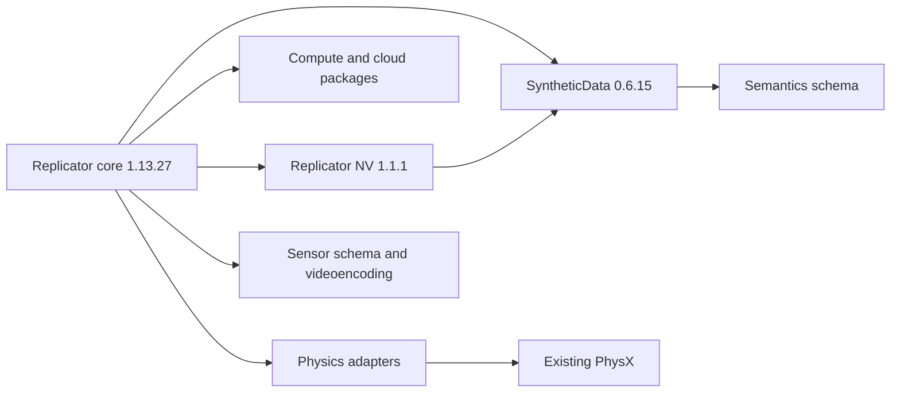

# Kit 110.2 annotation provider — dependency plan v1

9 November 2026. **Ready for dependency review. No installation or provider
activation was performed. M2 and Gate B remain incomplete.**

## Resolved candidate

Use the official **Replicator core 1.13.27** package
`omni.replicator.core-1.13.27+110.1.1.lx64.r.cp312`, with
`omni.replicator.nv-1.1.1+110.2.0.lx64.r.cp312` and native backend
`omni.syntheticdata-0.6.15+698af100.lx64.r.cp312`.

The current Kit is `110.2.0+feature.342835.698af100.gl`, Linux x86_64, release,
CPython 3.12. The native SyntheticData, semantics, sensor-schema and videoencoding
packages target hash **698af100 exactly**. Other selected packages satisfy the
runtime's platform, Python, release and minimum Kit filters. In particular,
Replicator's `target.kit = 110.1.1` is a minimum, not a request to downgrade Kit:
NVIDIA [documents the greater-or-equal matching rule](https://docs.omniverse.nvidia.com/kit/docs/kit-manual/110.1.5/guide/extensions_advanced.html#package-target).

The exact proposed isolated capture dependency set passed Kit's own metadata
solver with **127 selected extensions: 116 already installed and 11 additions**.
No existing package name/version is replaced. The roots pin USD 1.16.0,
OmniGraph core 3.1.3, RTX Hydra 1.0.4, renderer capture 2.0.1, viewport window
110.0.0, viewport utility 2.1.0, RTX settings 0.7.1 and loop-default 0.2.2.
The selected package IDs and complete graph are retained, rather than relying on
these abbreviated version names.

This is **metadata compatibility**, not an activation, ABI execution, image/AOV
or annotation qualification. Those checks are still required after a separately
approved installation. No sixteen-bundle dry result or marine label pass exists.

## Why the earlier lookup stopped, and what changed

The previous probes started with registry access disabled, then tried changing
the setting after startup; synchronization returned false. A new minimal private
app with index access enabled **from startup** synchronized successfully. Its
extension-installation destination was unwritable and remained empty. Installed
and enabled package IDs were unchanged. This supports startup gating as the
explanation for those earlier empty queries; it does not establish a NVIDIA
registry outage.

The 110.2 shared and build-specific SDK registries supply the native backend,
but not Replicator core. The private metadata comparison additionally queried
NVIDIA's [official 110 shared registry](https://docs.omniverse.nvidia.com/kit/docs/kit-registry-reference/latest/110/shared.html).
That supplied the minimum-version-compatible core, NV, cloud and compute
packages. The SDK remains pinned to the [official 110.2.0 / 698af100 registry](https://docs.omniverse.nvidia.com/kit/docs/kit-registry-reference/latest/110.2/110.2.0/sdk.html).
No registry setting was changed in the normal MARLIN app. After installation,
the proposed capture app operates offline with registry fallback disabled.

Four finite metadata probes were retained. The first synchronized correctly but
failed while exporting a solver result: this Kit build returns dictionaries for
solution entries, rather than the IDs described in the generic API manual.
The corrected export, shared-registry comparison and final capture-profile solve
all exited normally. The failure was not overwritten.

## Exact graph and package additions

The machine-readable [lock](../diagnostics/m2_dependency_plan_v1/provider_lock.json)
pins all 127 selected package IDs. The [dependency graph](../diagnostics/m2_dependency_plan_v1/dependency_graph.json)
records every selected edge and omitted optional dependency; the
[normalized vendor metadata](../diagnostics/m2_dependency_plan_v1/selected_extension_metadata.json)
retains original dependency constraints and target filters.

The eleven additions are listed with exact variants in the
[package table](../diagnostics/m2_dependency_plan_v1/PACKAGE_TABLE.md):

- Replicator core 1.13.27 and Replicator NV 1.1.1.
- SyntheticData 0.6.15, semantics schema 0.0.0 and sensor schema 0.0.0.
- Videoencoding 0.2.1.
- Vendored compute 1.9.2 and cloud 1.5.4 extension packages.
- Physics, PhysX adapter and stage-update adapter 110.1.1.

The three physics entries are additional adapter/umbrella packages; they reuse
the installed PhysX implementation. No driver, Kit, USD, renderer, installed
PhysX or Warp replacement is in this plan. The vendored pip extension packages
do not authorize a system/venv `pip install`.



This diagram highlights additions; the JSON graph is the full resolved graph.

## Object identity, checksums and disk estimate

Only index/JSON metadata, archive HEAD headers, and exact ZIP end-record /
central-directory byte ranges were read. No compressed extension file payload
was requested, no archive was downloaded as a package and nothing was extracted.
The directory ranges total **704,886 bytes**. All eleven archive HEAD checks
returned 200, and directory reads returned 206 with matching object validators.

The additions require **296,334,086 bytes compressed (282.61 MiB)** and
**619,687,466 bytes expanded (590.98 MiB)**, excluding filesystem allocation
overhead and later runtime caches. Exact file sizes, member CRCs, immutable S3
version IDs, opaque ETags and SHA256 hashes of the ZIP directory and end records
are retained in [the object pins](../diagnostics/m2_dependency_plan_v1/package_size_and_object_pins.json).
ETags are not presented as SHA256 or assumed to be simple MD5 values.

**Whole-archive SHA256 values remain pending.** File payloads have not been
downloaded, and the obtained vendor index did not provide an independent whole
archive SHA256. After review, the quarantine stage must enforce If-Match, object
version and byte count, compare the pinned ZIP metadata, test ZIP CRCs and record
each complete archive's SHA256 **before any unpacking**. This is a disclosed
provenance limit, not a claim that an unavailable vendor digest was verified.

Proposed caps are 2 GiB for quarantined archives plus expanded dependencies and
staging, and a separate 2 GiB allowance for the private runtime profile/caches.
Require at least 10 GiB free before beginning. The existing capture evidence
budget remains separate and unchanged. GPU admission stays at 2048 MiB free,
with the 768 MiB runtime floor. The extra annotation memory cost remains untested;
retain the fixed 512 x 384 single-product workload and stop on the guard.

## Proposed execution after review — not executed

The complete proposed argv lists, verification requirements and unpack calls are
in [planned_actions.json](../diagnostics/m2_dependency_plan_v1/planned_actions.json).
They all target the new private destination:

`/home/madil/kit-app-template/experiments/above_water_annotation_v1/dependencies/native_provider_1102_v1/`

1. Record a real named decision against this plan's manifest and lock. The
   supplied review template remains pending; it grants no approval. Recheck
   source/preset pins, host processes, disk and the exact package objects.
2. Create only the proposed private quarantine/staging directories. Download the
   eleven exact URLs with their pinned If-Match headers, at most 180 seconds per
   archive and 600 seconds for the download transaction. Reject changed metadata,
   unexpected object versions, incomplete files or size/cap violations. Do not
   substitute another package version after a failure.
3. Complete the whole-archive checks described above and seal the quarantine
   verification before unpacking. An object or directory-hash mismatch stops the
   plan; it requires a revised review, not an automatic refresh of accepted pins.
4. In a finite private Kit bootstrap using already installed components, use
   NVIDIA's [unpack_extension API](https://docs.omniverse.nvidia.com/kit/docs/kit-manual/110.1.2/omni.ext/omni.ext.unpack_extension.html)
   for these verified archives, with the private `extensions/` output and
   `skip_security_checks=False`. Do not write to normal `_build`, extscache,
   source, user caches or global Python paths. Inspect/validate only the new
   explicitly reviewed dependency destination if later necessary.
5. Start the prepared [candidate_capture.kit](../diagnostics/m2_dependency_plan_v1/candidate_capture.kit)
   with the existing Kit binary, existing packages as read-only runtime inputs,
   the private added-extension folder and a new private profile. Keep registry
   fallback disabled. Use the previously successful child-only headless setup;
   leave the Wayland desktop, kernel/IOMMU and driver unchanged.
6. Verify the exact loaded package IDs, provider imports, normal lifecycle,
   memory admission and annotator attachment/detachment. Check that import does
   not trigger any further dependency acquisition. Then resume the unchanged
   declared dry fixtures, same-frame provenance checks and sixteen capture
   bundles. Account for every retained capture attempt and stop at Gate B for
   named review. No geometric fallback can pass a failed native-mask requirement.

There was no live MARLIN process at the start or end of metadata work. Before a
later operation, recheck for newer live work; never close or overwrite it using
this historical observation. No current scene restoration was needed here.

## Preservation and rollback

The earlier M1 acceptance and 135-file M2 feasibility checkpoint remain unchanged.
Their status fields are dated snapshots. This plan supersedes only their
previous unresolved dependency lookup, not any annotation or sprint acceptance.
The new current pointer is `CURRENT_PROGRESS.json`; the sealed plan has its own
`status.json`. No prior manifest, acceptance record, production source or preset
was rewritten.

On a later failure, retain the failed archive/run and mark incomplete output
unusable. Terminate only the recorded owned process group. Detach owned
annotators/products where possible, then quarantine/remove only this plan's
private `extensions/`, staging and profile directories. Retain the evidence,
review record and archive hashes. The main app needs no source rollback or driver
rollback because neither is changed. Confirm the original service state,
source/preset hashes and GPU recovery. Do not remove generic user cache folders.

Read-only verification of this preparation:

```bash
/usr/bin/python3 -B experiments/above_water_annotation_v1/qa/m2_dependencies_v1/verify_plan.py
```

The review scope is an isolated engineering dependency candidate. It grants no
biological, optical, research-capture or ML approval. The separate ocean-material
M4 underwater-camera issue remains open.
