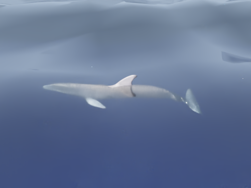
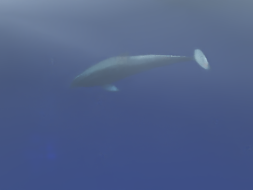
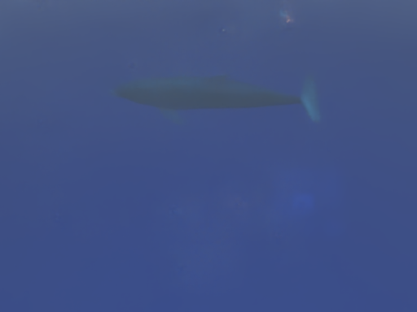

# Gate A — Above-Water Capture and Annotation Validation

Evidence version: **`above_water_m1_audit_v1`**. Date: **9 November 2026**. Status: **pending named review**. No reviewer or acceptance has been inferred.

**Decision requested:** accept the actual M1 audit, proposed label/capture contract, workload and numeric acceptance plan before implementation. The bounded next step begins with isolated native-provider and clean-lifecycle feasibility. It does not authorise new dependency installation, main MARLIN upgrades or a capture campaign before those prerequisites pass.

## What the review needs to consider

- The observed Kit is 110.2.0; neither Replicator nor SyntheticData registered in the queried profile. No native visible-mask support has been demonstrated. If new packages are required, a concrete isolated dependency proposal must return for review before installation.
- The metadata probe returned data but timed out during shutdown. That failure and the known importer errors are retained. A clean finite diagnostic lifecycle remains a prerequisite to later captures.
- Existing native HDR/EXR calls do not establish a shared image/annotation frame ID. The proposal adds a small optional helper after review, with explicit provenance and stale-state checks.
- Direct amodal geometry, raw native instance masks, mask-derived boxes and visual appearance references stay separate. Through-water mask validity is untested and can fail. Unsupported/ambiguous output cannot be relabelled as absence or a passed geometric fallback.
- The plan contains **120 bundles plus 24 reserve, maximum 144**, at 512 × 384, one product and one animal. Current ~2.3 GiB GPU headroom meets the proposed admission sample but is not a measured native-annotation capacity guarantee.
- M1 rendered **zero** new images. All 119 current source files and the accepted asset/water package remain unchanged. Bottlenose Gate D verification passes; the older ocean source-pin distinction is explicitly retained.

## Documents to review

1. [M1 audit and evidence interpretation](../M1_CAPTURE_ANNOTATION_AUDIT.md).
2. [Capture/label contract](../contracts/capture_contract.json).
3. [Numeric acceptance and resource plan](../contracts/acceptance_plan.json).
4. [Complete row-level capture declaration](../declarations/capture_declaration.json), including the 21 sentinel and 12 named marine-review rows.
5. [Smallest implementation proposal and dependency stop](../reports/IMPLEMENTATION_PROPOSAL.md).
6. [Verification and rollback rules](../REPRODUCTION_AND_ROLLBACK.md).
7. [Read-only audit verification result](../qa/m1/verification.json) and [sealed packet file manifest](../manifest.json).

## Representative baseline material

These are byte-identical copies of **historical accepted demonstration displays**, using the same fixed Reinhard mapping. They are not new camera/annotation validation results and contain no new visible-mask overlay. Source state, scene and HDR hashes are bound by [image provenance](../baseline/representative_images.json).

**t = 6 s — shallow steady swimming; proposed pose A source.**

**t = 30 s — existing limited descent attitude; proposed pose B source.**

**t = 38.25 s — submerged appearance and reduced contrast.** This is context for the annotation uncertainty problem, not an extra selected primary pose.

DigitalLife3D, **Model 61A — Bottlenose Dolphin**, CC-BY-NC-4.0. Original source/licence remain associated with the asset and are pinned in this packet.

## Acceptance boundary

An acceptance should identify the reviewer, this evidence version/manifest, acceptance of the declared engineering thresholds and the dependency/lifecycle limitations. It permits only the bounded next work described above, with the installation stop retained. It grants no biological, optical, survey, research-dataset or ML approval and does not close the separate ocean-material M4 case.

Suggested decision wording, **not an acceptance record**:

> Accept Gate A as MAR for `above_water_m1_audit_v1`, including the bounded native-provider feasibility step, declared capture/annotation plan and stop before any required new dependency installation.

Alternatively request changes to specific criteria/scope. Earlier Gates A–D from the completed dolphin sprint do not approve this new gate. **Work has stopped at Gate A.**
