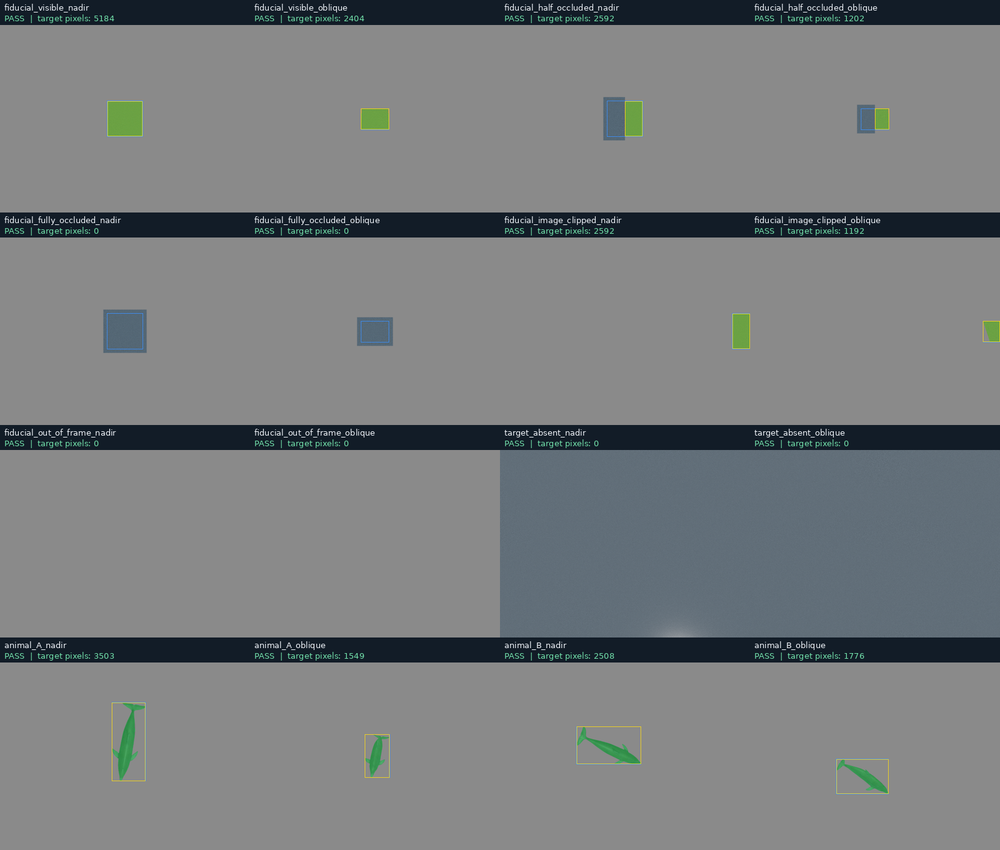
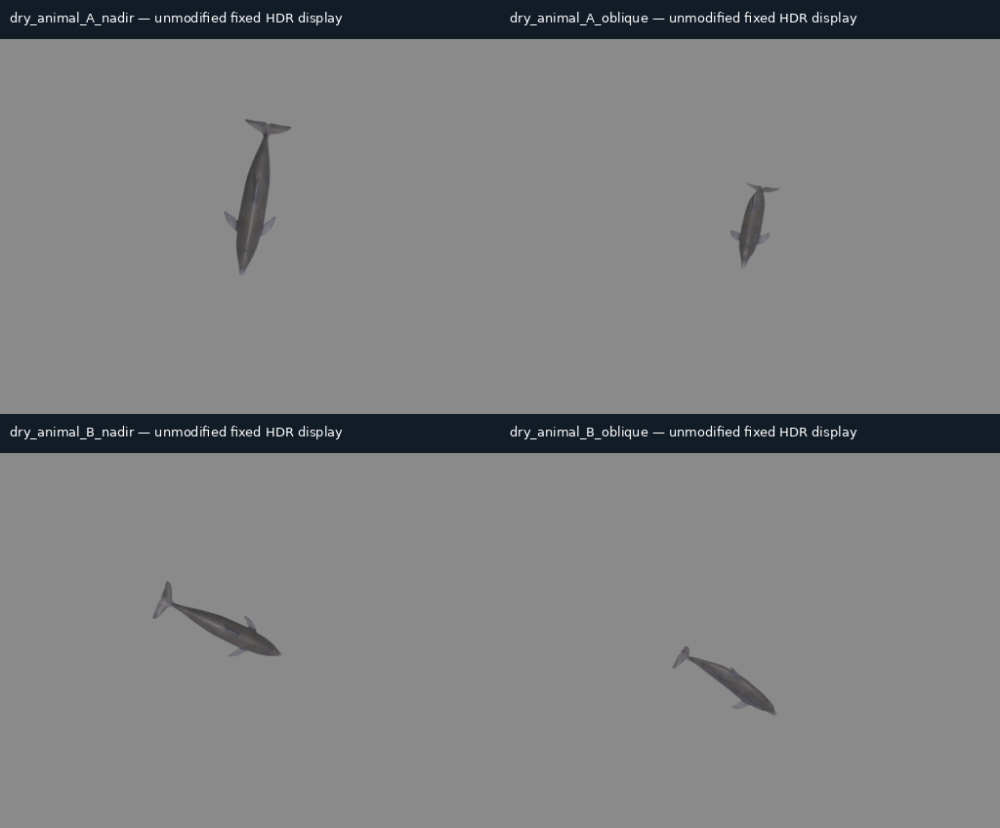

# Gate B — dry geometry and native-label review

Status: **pending new named human review**. Candidate: **above_water_m2_dry_validation_v1**. No approval has been inferred from MAR's dependency-installation approval.

Please review the [complete M2 report](../reports/M2_DRY_ANNOTATION_VALIDATION.md), [sixteen-case summary](../diagnostics/m2_execution_v1/dry_validation_summary.json), [stale-state check](../diagnostics/m2_execution_v1/stale_validation.json), and [frozen-pose verification](../diagnostics/m2_execution_v1/frozen_pose_verification.json).

The proposed acceptance is bounded dry engineering evidence: camera projection, opaque-geometry occlusion/identity, raw renderer-instance masks, half-open mask boxes, native box conversion, immutable-state timing and exact replay of the two accepted body phases. The selected mask API is NVIDIA's hidden/development `instance_id_segmentation`, cross-checked with native SDK IDs/paths/semantics. The standard instance API's empty prim paths remain unqualified. A completely geometry-empty product remains unsupported; target-absence controls include a distinct non-target background. The vendor Fabric interface warning is retained. Per-AOV frame IDs are unavailable; native timing plus immutable state and the alternating diagnostic provide the explicitly weaker assurance.

Please inspect that the green overlays cover the intended target, the yellow boxes enclose visible pixels, the blue boxes describe direct geometry, and empty controls remain empty for the owned target. Separate unmodified `display.png`, `hdr.npz`, `hdr.exr` and raw native arrays are available through each selected row's folder in the JSON summary. Corners/centre are analytic geometric landmarks; no encoded optical-marker detection is claimed.

Accepting this candidate would close M2 for these dry products and permit bounded M3 interface qualification. It would **not** approve the broken standard API, geometry-empty products, per-AOV synchronisation, marine/transmitted labels, real-seawater optics, biological validity or research/ML capture. The ocean-material M4 support case remains open. Request changes instead if the development API or these assurance limits are unsuitable.

Reviewer: **pending**. Decision: **pending**. M3 remains stopped.
