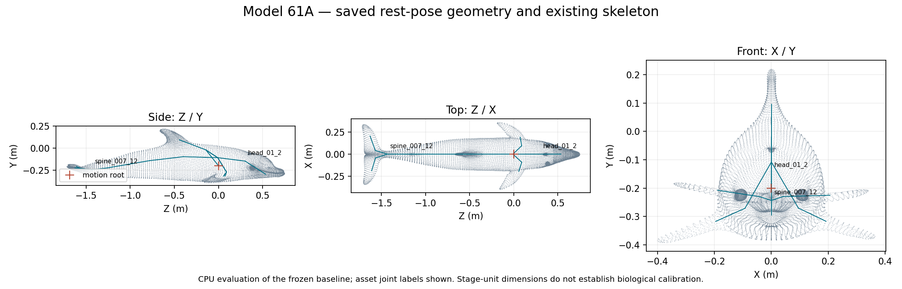

# GAMA–Omniverse bottlenose behaviour and animation — M1

Prepared 5 November 2026. **Audit ready; Gate A review pending.**

Sprint: **MARLIN — GAMA–Omniverse Bottlenose Dolphin Behaviour and Animation**.

Start with the [M1 audit](M1_ASSET_AND_CONTROLLER_AUDIT.md), then read the
[proposed implementation scope](IMPLEMENTATION_PROPOSAL.md) and
[Gate A review packet](reviews/GATE_A_REVIEW.md).

The audit identified the existing DigitalLife3D Model 61A dolphin and its
20-joint skeleton. A compatible existing swim-cycle file is available, but no
animation is bound to the current live animal. The legacy GAMA bottlenose
adapter selects a different asset; the newer adapter is specific to a harbour
porpoise. A bounded extension of the existing bridge is proposed for review.

No production source, animal asset, behaviour, animation, accepted water
preset or historical evidence was changed. The live scene was inventoried,
two frozen scene checkpoints were saved, and one current viewport preview
was retained. The preview is washed out and is not a qualified HDR result or
a useful deformation review. The geometry sheet below is a CPU diagnostic.

Evidence:

- [Baseline and dependency manifest](baseline_manifest.json).
- [USD/glTF/animation inventory](qa/asset_inventory.json).
- [Asset and bake provenance](qa/asset_provenance.json).
- [Current live state](baseline/live_before/inspection.json) and
  [saved checkpoint](baseline/live_before/checkpoint.json).
- [Preservation checks](qa/final_preservation.json).
- [Historical GAMA source-pin disposition](qa/historical_gama_source_pin_disposition.json).
- [Baseline recovery instructions and limitations](BASELINE_RECOVERY.md).

The sprint document is retained byte-for-byte in
[specification/source_document.md](specification/source_document.md).
The accepted ocean-material M5/M6 package remains a separate experiment.

**Stop here for Gate A.** The [review record](reviews/gate_a_review.json) has
no inferred reviewer or approval. M2–M6 have not started under this sprint.
