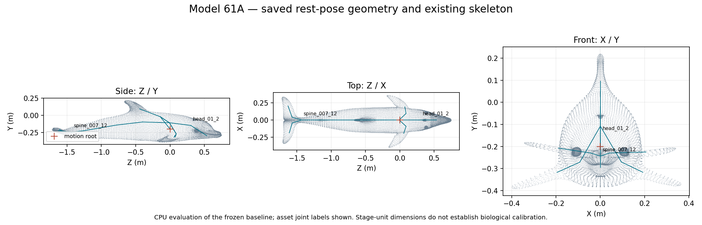

# Gate A review packet — M1 audit and proposed scope

Evidence version: **m1_audit_v1**, prepared **5 November 2026**.
Status: **pending named review**. No approval has been inferred.

The current sprint requires a named reviewer to accept the actual
asset/controller audit and smallest implementation scope before behaviour or
animation work begins. See the preserved
[Gate A requirement](../specification/source_document.md#acceptance-criteria--gate-a).

## Read these first

1. [M1 audit and baseline findings](../M1_ASSET_AND_CONTROLLER_AUDIT.md).
2. [Proposed implementation scope](../IMPLEMENTATION_PROPOSAL.md).
3. [Restoration scope and limitations](../BASELINE_RECOVERY.md).
4. [Preservation checks](../qa/final_preservation.json) and
   [baseline manifest](../baseline_manifest.json).

The geometry sheet uses the existing frozen rest pose and asset joint labels.
It does not show a newly implemented swim cycle or certify anatomical landmarks.
The [new live viewport PNG](../baseline/preview_01/current_viewport.png) is
washed out and unsuitable for judging deformation. The
[previous accepted water-demo comparison](../../ocean_material_v1/diagnostics/m6/figures/material_comparison.png)
shows this same asset under its earlier controlled capture settings; its date
and engineering-only acceptance remain unchanged.

## Decision requested

Accept, request changes to, or reject this bounded scope:

- Use the exact DigitalLife3D Model 61A asset, current engineering scale and
  unchanged materials; preserve the original asset and accepted water preset.
- Extend the existing GAMA bridge with one explicitly versioned private
  bottlenose actor, preserving prior v1/v2 contracts and evidence.
- Reuse the existing 20-joint rig and matching 1.25 s baked swim cycle, with
  simulation-time-indexed per-instance pose evaluation and one world-motion
  owner. No replacement rig or substantial asset work is preapproved.
- Define/test the ownership, coordinate, depth and timing contract in M2,
  including numerical tolerances before later acceptance runs.
- Retain separate later review gates for trajectories, coordinated manoeuvre
  animation and the integrated demonstration; return for refinement scope if
  the existing cycle cannot support the required body response.

The live baseline currently has no bound clip, no running animal movement and
no enabled GAMA routes. The current water selection is original; the unchanged
accepted `engineering_v1` preset would be selected explicitly for later tests.
The existing frozen checkpoint does not serialize complete controller phase.
Biological suitability remains provisional.

A response should identify the reviewer, decision, evidence version and any
scope changes. For example, if accurate:

> MAR accepted Gate A for m1_audit_v1 and the bounded scope in
> IMPLEMENTATION_PROPOSAL.md, with biological suitability remaining provisional.

This example is not a review record. The machine-readable
[gate_a_review.json](gate_a_review.json) remains pending until an actual decision.
M1 acceptance and M2 implementation must not be marked complete/started on
the basis of Codex's audit alone.
