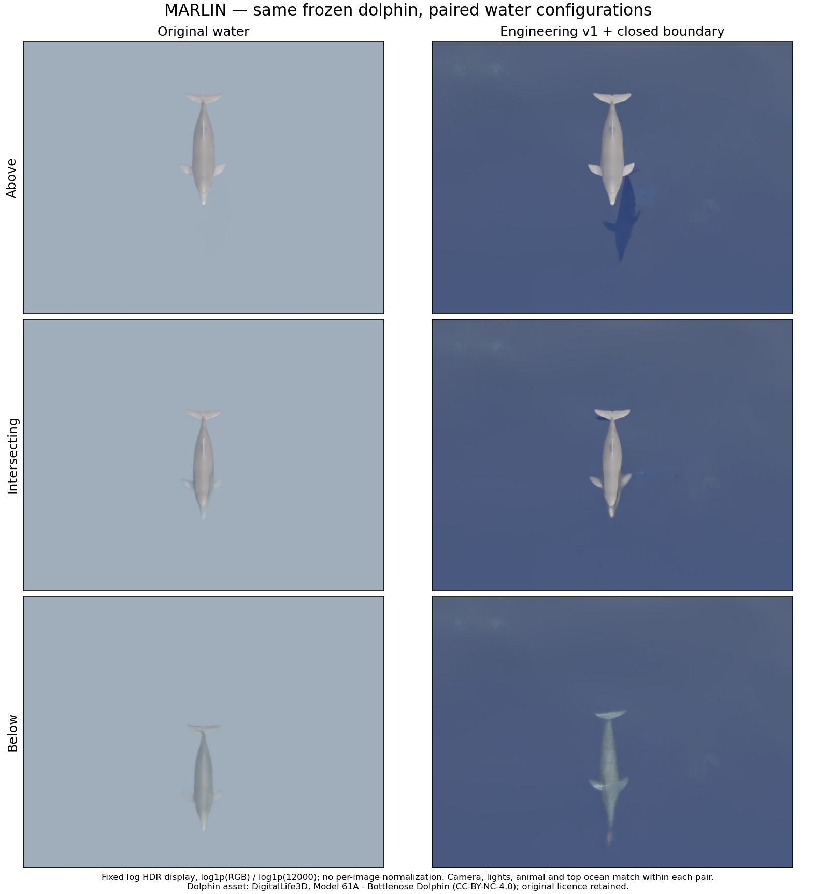
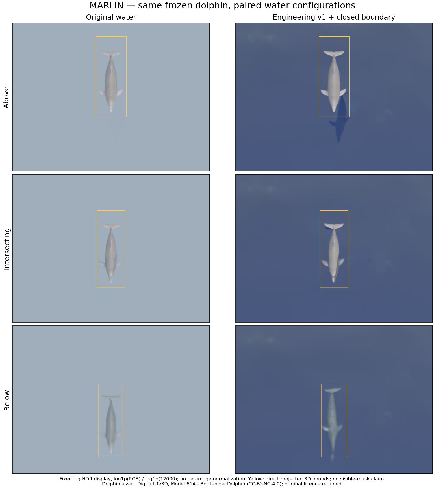
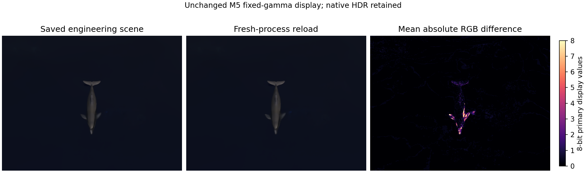

# Material demonstration review — MAR

Status: **awaiting named human review**. Technical checks have passed for the declared above-water-camera HDR configuration; M4 remains open. This packet does not reuse prior sprint approval.

Please assess whether the paired images provide an acceptable engineering demonstration of the water material and its required medium boundary on the unchanged existing dolphin. All cameras remained above water, including when the animal was submerged. The original animal mesh, scale, material, anatomical pose and orientation were preserved; only inspection Y placement varied between rows.

The new configuration changes water appearance, transmission/refraction, scattering and reflected/shadowed surface features. It does not improve the animal asset itself. The closed side/bottom boundary is an explicit part of the new water configuration, so the result is not an isolated one-parameter shader experiment. Images use one fixed log HDR mapping, with no per-image normalization.

Yellow boxes are direct projections of the same 3D asset bounds within each pair. Visible/refracted contours and surface reflection/shadow features need not follow those direct boxes; the above-water engineering image has a conspicuous water feature outside the direct animal box. No existing labels were changed, no raster mask was created and no numerical visible-mask accuracy is claimed. Crop colour differences are appearance diagnostics, not mask-error or refraction-displacement measurements.

The fresh-process reload passed full-image MAD 0.0457 and p99 1, versus limits 1 and 8 in 8-bit units. Rollback passed the same gate. The earlier in-process stage switch did not complete and remains unqualified. M6 camera far clipping was declared from geometric framing (approximately 34.21 m), rather than silently inheriting the smaller fiducial camera range.

The original inside-camera defect still reproduced on driver 595.99.02 with valid above-water controls. Native LDR PNG clipping, unmeasured hardware sample counts and lack of optical/biological/field validation remain explicit limitations.

Review scope: **engineering acceptance of this demonstration**, not real-seawater or wildlife-survey validation and not closure of M4. Reviewer identifier: **MAR**. The current sprint requires this new named human review; acceptance remains unrecorded until the human responds.

Dolphin asset: DigitalLife3D, Model 61A - Bottlenose Dolphin; original CC-BY-NC-4.0 attribution/licence preserved in the preset package.
