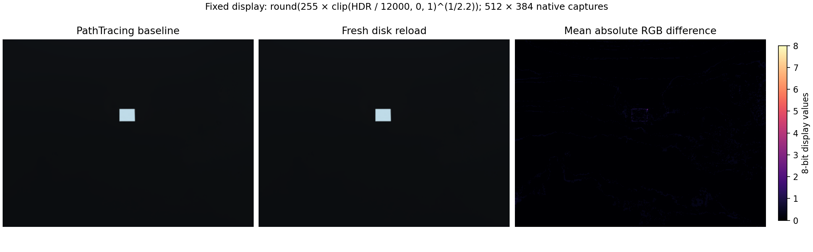
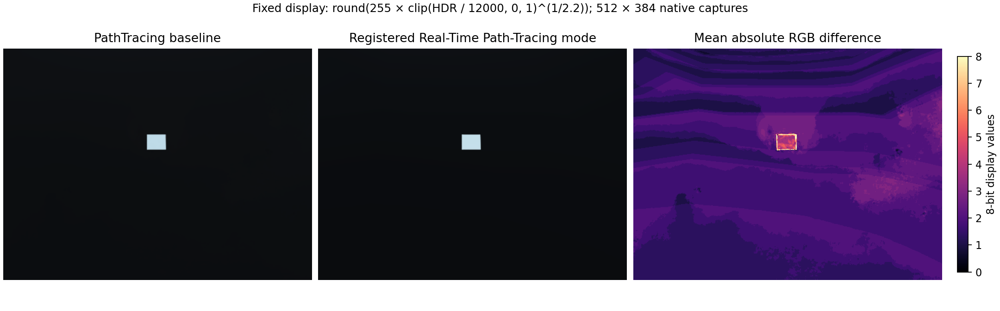
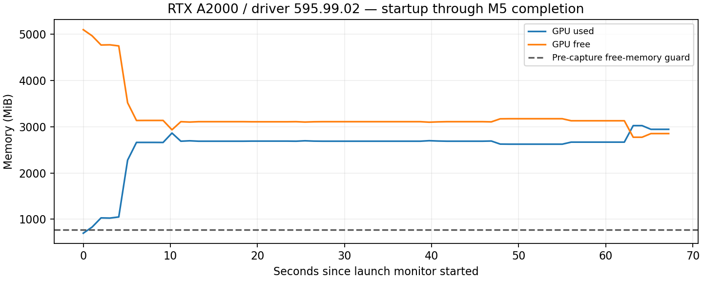

# M5 — Verify saved-image rendering and resource requirements

Sprint: **MARLIN — Ocean Material and Underwater Appearance**. Updated **3 November 2026**.

**The bounded above-water capture, repeatability, fresh-stage reload and resource checks passed for native HDR/EXR with a deterministic display conversion in PathTracing.** The default native LDR PNG remained fully clipped under the recorded exposure and is not qualified as useful RGB output. This supported configuration and limitation are explicit; the default PNG route was not silently certified. M4's camera-inside-water attenuation defect remains open with NVIDIA, and the sprint is not complete.

## Driver recovery and restored application

The user rebooted the computer. The running kernel changed from 7.0.0-38-generic to **7.0.0-42-generic**; the loaded NVIDIA module, installed module and `nvidia-smi` now agree on **595.99.02**. The old mismatch between loaded 595.91.07 and NVML 595.99 was resolved without replacing, purging or downgrading packages. Initial free memory before launching MARLIN was approximately 5 GiB; this is an observation, not a permanent memory fix.

MARLIN was restored from hash-verified checkpoint **checkpoint_6x3ggjpt**. The saved camera, resolution, fill mode and renderer settings matched. Two subsequent graceful, checkpointed Kit restarts loaded local audit corrections; no further host reboot occurred. After every attempt, the retained live stage and settings were restored. The recorded standard ocean/chase controllers were reconstructed with swimming stopped. Procedural phase and GPU history were reset rather than preserved.

Final live API checks confirmed the ocean and chase camera running, swimming stopped, original material selected, and camera/resolution/fill/renderer/display settings matching the pre-reboot checkpoint. The final recovery checkpoint is **checkpoint_1p1j87ik**. All **113 canonical source files** and **2,342 historical evidence entries** remained unchanged. M5 added diagnostic scripts and evidence, with no application-source edits.

## Tested configuration and actual capture route

| Item | Recorded configuration |
| --- | --- |
| Host / GPU | madil-CRIS-UL / NVIDIA RTX A2000, 6,138 MiB total |
| Kit / driver | 110.2.0+feature.342835.698af100.gl / 595.99.02 |
| Production capture mode | Exact installed token `PathTracing` |
| Fixture | Sealed M4 engineering_v1 ocean, frozen phase 0, above-water oblique camera |
| Route | Existing `omni.kit.viewport.utility` file/buffer capture SDK used by MARLIN experiments; one live context and viewport |
| Saved output | 512 × 384 square pixels; native HdrColor NPZ + EXR, native PNG retained, derived display PNG |
| Camera | `/World/MarlinOceanIntegrationDiagnostic/Camera`; 35 mm focal length; 20.48 × 15.36 mm aperture |
| Projection | Authored camera frustum and actual render product validated independently of the UI window; matching full-image aspect |
| PT budgets | Configured 512 samples/pixel, 1/iteration; total/glossy bounce limits 16/16; `pt:limits:maxVolumeBounces=2`, separate `pt:maxVolumeBounces=15` recorded |
| Denoising / temporal | PT denoising enabled; OptiX temporal mode, PT temporal accumulation and PT adaptive sampling disabled |
| Reconstruction settings | PT DLSS disabled; separate post-AA token `dlss` and post-DLSS `auto` recorded, without assuming those settings imply active reconstruction in PT |
| Exposure / colour | Camera auto-exposure disabled; exposure 0, ISO 100, time/f-stop/responsivity 1; `acesApproximation`, `sRGBLinear`, sRGB-to-gamma enabled, dithering 0 |
| Other controls | Product fog disabled; PT and RTPT firefly filters disabled; engineering medium retained |

The complete effective camera/product inventory, global settings and matrices are retained per capture. `../diagnostics/m5/validated_capture_settings.json` packages the supported configuration. Unresolved precedence between similarly named product settings is not represented as measured ray telemetry.

Each capture waited for **64 completed rendered frames**, then discarded a warmup PNG before saving. The 30-second frame wait, 60-second image coroutine, 300-second suite and 768 MiB pre-capture memory guard were retained. **Configured 512 samples/pixel is not a measured completed GPU sample count.** No hardware sample-count or absolute radiometric-calibration claim is made. Native HDR buffer and EXR were separate SDK captures of the same frozen state, rather than asserted identical stochastic samples.

## Visible output and prospective protocol amendments

`PLAN.md` preserved the M1 full-frame and fixed central ROI tolerances: MAD ≤ **1/255**, p99 ≤ **8/255**, maximum difference reported, and camera matrices within **1e-6**. ROI bounds were x=[128,384), y=[96,288). Scene/settings equality was checked separately using the existing canonical `same_settings` comparator.

The post-reboot attempt01 timed out before the first RTX-ready frame, with no image accepted. All six restoration checks passed. A recorded readiness amendment added a separate initial three-rendered-frame readiness check, bounded at 90 seconds, while leaving the actual capture limits unchanged. Attempt02 then completed five native capture/reload cases, but its native PNGs were all white. Zero differences in those clipped PNGs were explicitly treated as uninformative. Its missing mode comparison was a harness token-lookup error, not evidence that the mode was unavailable.

Before collecting **new attempt03 images**, `ATTEMPT03_DISPLAY_PROTOCOL.md` declared the additional supported display output:

```text
round(255 * clip(native_HDR_RGB / 12000, 0, 1) ** (1/2.2)), cast to uint8
```

Scale 12000 and gamma 2.2 reused the earlier M3 display convention. This conversion used no per-frame normalization, fitted scale or automatic exposure. Its processor source was pinned before the new captures. The new visible images had values 11–234 in the five PT cases, with no values clipped at 255, and passed the unchanged full-frame and ROI tolerances. Native PNGs, native HDR and failed attempts were all retained. The output pipeline changed explicitly; the clipped native PNG route was not relabelled as working.

## Repeat and actual save/reload results

Attempt03 captured a new baseline, two repeats on the same frozen stage, and two independent fresh anonymous-layer reads from the new M5 saved scene. The saved file was not replaced by a fixture rebuild. Three distinct layer identifiers, unchanged input file hash, all 46 evaluated non-render scene-prim hashes, camera matrices, effective camera/product controls and global settings verified the reloads. The maximum observed camera matrix difference was **0**.

Saved scene SHA-256: `d6fa90be0a2791ca8525d642f1d237178911946d4217dd58e15800e99a424904`.

Values below are 8-bit display units, except the final HDR percentage. p99 is the full-frame value; ROI p99 was also 1 in every comparison. Maximum difference was reported, not gated; the declared 8-unit limit applies to p99.

| Comparison | Full RGB MAD | ROI MAD | p99 | Maximum | Native HDR relative MAD | Result |
| --- | ---: | ---: | ---: | ---: | ---: | --- |
| repeat_a | 0.08619 | 0.06976 | 1 | 7 | 0.787% | Passed |
| repeat_b | 0.10735 | 0.08985 | 1 | 9 | 0.936% | Passed |
| reload_a | 0.01534 | 0.01482 | 1 | 6 | 0.170% | Passed |
| reload_b | 0.01523 | 0.01476 | 1 | 6 | 0.169% | Passed |

HDR relative MAD is mean absolute native HDR difference divided by mean absolute baseline signal. It is additional diagnostic evidence, not a retrospective HDR pass threshold or per-pixel relative error. PNG equality was not substituted for the visible display measurements.



## Installed renderer comparison

The registered allowed tokens were `RaytracedLighting`, `PathTracing`, **`Real-Time Path-Tracing`** and `Minimal`. The last is not a production water mode. The comparison used the exact registered real-time token; it was not renamed to Real-Time 2.0. Both saved outputs retained the same scene, matrices, exposure and global settings; the only recorded effective camera/product control change was `omni:rtx:rendermode`.

The comparison completed in **6.64 seconds**. Its native HDR relative MAD versus PT was **12.28%**. No identical-pixel gate applied across modes, and that difference does not isolate any individual lighting/volume/denoising mechanism. **PathTracing remains the qualified mode**; cross-mode equivalence and camera-inside attenuation are not claimed.



## Resource and failure observations

The successful attempt03 recorded **67 GPU observations** at approximately one-second intervals, spanning startup through audit completion. Peak-observed usage was **3025 MiB** and minimum observed free memory **2774 MiB**. This is a sampled peak over that interval, not an exact allocation peak or a guarantee for other scenes. The five PT image coroutines took **7.64–7.80 seconds** each. These timings include frame settling, capture and state recording, and exclude initial startup, stage attachment and initial renderer readiness.

| Attempt | Outcome | Peak observed used / minimum free |
| --- | --- | --- |
| Pre-reboot | NVML exit 18; existing guard refused rendering | Unavailable, not zero |
| 01 | 30.03 s initial 64-frame timeout before first RTX-ready frame; restored cleanly | 2,290 / 3,508 MiB |
| 02 | Five captures/reloads completed; native PNG clipped; comparison token lookup corrected later | 2,952 / 2,846 MiB |
| 03 | Five qualified PT captures plus one registered-mode comparison; all restoration checks passed | 3,025 / 2,774 MiB |

No capture size, camera sampling, medium or required effect was silently reduced. A 512 × 384 explicit product was used throughout. No second renderer/context was allocated, and no memory guard was bypassed. The native-LDR failure was addressed with a separately declared and tested HDR display pipeline, while preserving the original output. Existing asset-converter/libxml2 startup errors remained unrelated; asset conversion was not used.



## Evidence, checks and scope

- `../diagnostics/m5/runs/attempt03/analysis.json`: actual image/state comparisons, reload verification and resource summary.
- `../diagnostics/m5/runs/attempt03/`: PNG, NPZ, EXR, derived display images, effective controls, saved scene, runtime versions and restoration checks.
- `../diagnostics/m5/qa/resource_and_failure_log_final.json`: links to preserved failures, every attempt and restart accounting.
- `../diagnostics/m5/qa/final_live_verification.json`: restored live ocean/chase/material/settings and final checkpoint.
- Ten comparison/display-tool tests and five existing renderer-snapshot tests passed. Actual GPU capture/reload/restoration checks passed separately. PNG and NPZ dimensions were decoded independently; `file` independently identified all six EXRs as 512 × 384 OpenEXR outputs.
- Protected evidence/source hashes and pre-capture processor pins were verified. Sealed copies of the still-running Kit logs were retained; live log originals are excluded from immutable hashes.

**Supported:** this bounded, above-water engineering_v1 fixture in PathTracing, native HDR/EXR plus the declared fixed display conversion, within the observed host/configuration limits. **Unsupported or unqualified:** useful native LDR PNG under this exposure, camera-inside-water attenuation, general cross-mode equivalence, absolute radiometric or biological calibration, full native HiDef/Sony output and a new fresh-process reproducibility claim. M4 remains open and the overall sprint remains incomplete. The new-driver run does not retroactively requalify earlier evidence on the old driver.
